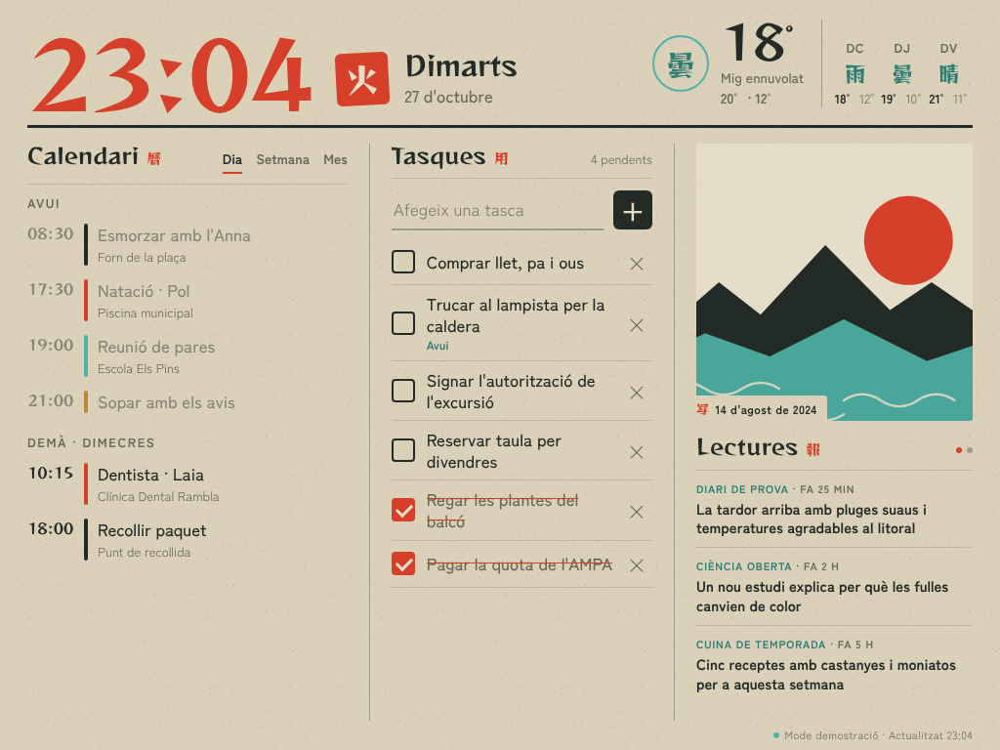

# Kazoku 家

Dashboard familiar per a un iPad mini 2 (iOS 12) penjat a la paret. Mostra rellotge, temps, calendari familiar, tasques editables, foto del dia i lectures RSS.



Demostració sense configurar res: obre `index.html?demo`.

## Com funciona

```
iPad / mòbils ──► GitHub Pages (aquest repositori: HTML, CSS, JS)
                        │  JSONP + token
                        ▼
              Google Apps Script (el teu compte)
              ├─ Google Calendar   (calendaris visibles o els que triïs)
              ├─ Google Tasks      (llegir, afegir, marcar, esborrar)
              ├─ Google Drive      (carpeta de fotos)
              ├─ Open-Meteo        (temps, sense clau)
              └─ Canals RSS/Atom
```

- El repositori no conté cap secret. L'URL de l'Apps Script i el token es passen un sol cop pel fragment de l'URL (`#api=...&k=...`) i queden desats al dispositiu.
- El JavaScript és ES5 pur, sense dependències: funciona al Safari d'iOS 12.
- Les tipografies (Reggae One i Zen Kaku Gothic New, llicència OFL) estan allotjades al repositori.

## Fotos: per què una carpeta de Drive i no un àlbum de Google Fotos

Des del 31 de març de 2025, Google no deixa que apps de tercers llegeixin àlbums de Google Fotos. La foto del dia surt d'una carpeta de Google Drive. Opcions per omplir-la:

- Descarregar un àlbum de Google Fotos i pujar-lo a la carpeta.
- Fer que el mòbil hi desi fotos automàticament (app de Drive o una drecera).

## Muntatge

### 1. Backend (Google Apps Script)

1. Ves a <https://script.google.com> i crea un projecte nou (per exemple, "Kazoku").
2. A **Configuració del projecte**, activa "Mostra el fitxer de manifest appsscript.json".
3. Substitueix el contingut de `Code.gs` i `appsscript.json` pels d'aquesta carpeta `apps-script/`.
4. Edita `CONFIG` a `Code.gs`:
   - `TOKEN`: una cadena llarga i aleatòria.
   - `CALENDAR_IDS`: buit per a tots els calendaris visibles, o els IDs del calendari familiar.
   - `PHOTO_FOLDER_ID`: la part final de l'URL de la carpeta de Drive.
   - `LAT` / `LON`: la teva ubicació (2 decimals).
   - `FEEDS`: els canals RSS que vulguis.
5. Executa la funció `provaConfiguracio` des de l'editor i accepta els permisos. Al registre has de veure esdeveniments, tasques, temperatura, articles i foto.
6. **Desplega > Desplegament nou > Aplicació web**:
   - Executa com a: **Jo**
   - Qui hi té accés: **Qualsevol**
7. Copia l'URL que acaba en `/exec`.

Cada vegada que canviïs `Code.gs`, fes **Gestiona els desplegaments > Edita > Versió nova** perquè l'URL continuï sent la mateixa.

### 2. Frontend (GitHub Pages)

1. Puja aquest repositori a GitHub (pot ser públic: no conté secrets).
2. **Settings > Pages > Deploy from a branch > main / root**.
3. L'adreça serà `https://USUARI.github.io/REPOSITORI/`.

### 3. Configurar cada dispositiu

Obre aquesta adreça al dispositiu (codifica l'URL de l'Apps Script amb `encodeURIComponent` si conté caràcters especials; normalment no cal):

```
https://USUARI.github.io/REPOSITORI/#api=URL_DE_L_APPS_SCRIPT&k=EL_TEU_TOKEN
```

Els mòbils de la família poden fer servir la mateixa adreça per afegir i marcar tasques. A pantalla estreta, les tasques surten primer.

### 4. Convertir l'iPad en marc

1. Al Safari de l'iPad, obre l'adreça del pas 3 i fes **Compartir > Afegir a la pantalla d'inici**. S'obrirà a pantalla completa, sense barres. Fes-ho amb el `#api=...` a l'URL: l'app de la pantalla d'inici té un emmagatzematge separat del Safari.
2. **Ajustos > Pantalla i brillantor > Bloqueig automàtic > Mai**.
3. **Ajustos > General > Accessibilitat > Accés guiat**: activa'l i posa un codi.
4. Obre Kazoku i fes triple clic al botó d'inici per bloquejar-lo dins l'app.
5. Recomanat: endoll intel·ligent que carregui l'iPad unes hores al dia per protegir la bateria.

## Comportament

| Bloc | Refresc | Notes |
|---|---|---|
| Rellotge | cada minut | Segell vermell amb el kanji del dia de la setmana |
| Tasques | cada 60 s | Toca per marcar. `×` i després "Esborrar" per eliminar. Les completades desapareixen al cap de 24 h |
| Calendari | cada 10 min | Dia, Setmana, Mes. Torna a "Dia" després de 3 min sense tocar |
| Temps | cada 30 min | Kanji: 晴 serè, 曇 núvols, 雨 pluja, 雪 neu, 雷 tempesta, 霧 boira, 夜 nit serena |
| Foto | segons `PHOTO_ROTATE_HOURS` | Toca la foto per veure-la a pantalla completa |
| Lectures | cada 30 min | Gira cada 20 s. Toca un titular per llegir-ne el resum |

- **Mode nit** de 23:00 a 7:00: tons foscos i foto atenuada. El primer toc el desperta 5 minuts.
- **Recàrrega preventiva** cada 6 hores, per evitar fuites de memòria del Safari d'iOS 12.
- Tots aquests valors es canvien a `SETTINGS`, al principi de `js/app.js`.

## Paleta

| Nom | Hex | Ús |
|---|---|---|
| Washi | `#DBD0B8` | Fons |
| Washi clar | `#E6DDC9` | Superfícies |
| Shu (vermelló) | `#D63F2A` | Rellotge, segell, accents |
| Asagi (turquesa) | `#4FB3A9` | Temps, detalls |
| Sumi (tinta) | `#232B26` | Text i línies |
| Kincha (ocre) | `#B8873A` | Quart calendari |

## Fitxers

```
index.html            estructura
css/style.css         estil (iOS 12: Grid, variables, sense flex-gap)
js/app.js             lògica (ES5)
js/demo.js            dades d'exemple per a ?demo
fonts/                tipografies (OFL)
img/                  textura de paper, icona, imatge per defecte
apps-script/          backend per copiar a script.google.com
```
